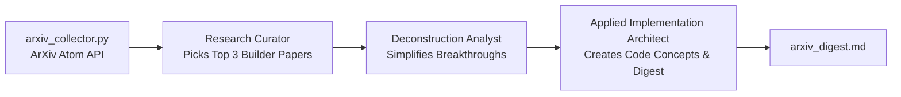

# 🧠 ArXiv Research Synthesizer Agent

An autonomous multi-agent Crew that tracks cutting-edge research papers from arXiv (AI, LLMs, Software Engineering) and **distills them into actionable developer takeaways and code patterns**.

---

## 💡 Why This Agent?

- **Eases Your Life:** Skips through mathematical proofs and dense academic jargon to extract only the practical engineering breakthroughs you can actually use.
- **Enhances Your Profile:** Keeps your knowledge months ahead of mainstream tech articles, providing ideas for innovative projects and technical discussions.

---

## 🤖 The Multi-Agent Architecture



---

## 🚀 Quickstart

### 1. Installation

```powershell
# In E:\projects\AiAgentS\arxiv-digest-agent
pip install -r requirements.txt
```

### 2. Configure Environment

Copy `.env.example` to `.env`:

```powershell
cp .env.example .env
```

Set your `GEMINI_API_KEY`.

### 3. Run the Agent

```powershell
python crew_arxiv.py
```

### 4. Output

Generates `arxiv_digest.md` with 30-second summaries, breakthroughs explained, direct PDF links, and developer code takeaways.

