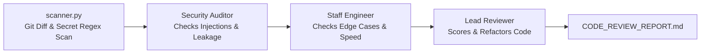

# 🛡️ Code Review & Security Copilot Agent

An autonomous multi-agent Crew that reviews codebases, git diffs, and individual files for **security vulnerabilities, API key leaks, unhandled edge cases, and performance bottlenecks**.

---

## 💡 Why This Agent?

- **Eases Your Life:** Acts as an instant senior peer-reviewer before you push to remote or open a pull request.
- **Enhances Your Profile:** Prevents embarrassing bugs, broken builds, and leaked keys from ever reaching your public GitHub profile.

---

## 🤖 The Multi-Agent Architecture



---

## 🚀 Quickstart

### 1. Installation

```powershell
# In E:\projects\AiAgentS\code-reviewer-copilot
pip install -r requirements.txt
```

### 2. Configure Environment

Copy `.env.example` to `.env`:

```powershell
cp .env.example .env
```

Set your `GEMINI_API_KEY`.

### 3. Run the Agent

You can point it to any file, git folder, or uncommitted repo:

```powershell
# Review a single script
python crew_reviewer.py ../ai-news-agent/crew_news.py

# Or review an entire project / git diff
python crew_reviewer.py ../ai-news-agent
```

### 4. Output

Generates `CODE_REVIEW_REPORT.md` with:
- Security rating (Safe / Warning / Critical)
- Edge-case analysis & failure modes
- Before & After refactoring suggestions
- Reliability scorecard

