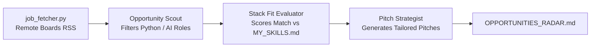

# 🎯 Niche Opportunity & Job Radar Agent

An autonomous multi-agent Crew that tracks remote software developer openings, matches them against your custom tech stack (`MY_SKILLS.md`), calculates match scores, and drafts **personalized 3-sentence outreach pitches**.

---

## 💡 Why This Agent?

- **Eases Your Life:** Replaces manual job board browsing and recruiter spam by surfacing high-signal remote roles.
- **Enhances Your Profile:** Identifies emerging skills that high-paying roles are asking for and generates targeted outreach messages.

---

## 🤖 The Multi-Agent Architecture



---

## 🚀 Quickstart

### 1. Installation

```powershell
# In E:\projects\AiAgentS\job-radar-agent
pip install -r requirements.txt
```

### 2. Configure Environment & Skills

Copy `.env.example` to `.env`:

```powershell
cp .env.example .env
```

Set your `GEMINI_API_KEY`. Customize your background in `MY_SKILLS.md` if you wish!

### 3. Run the Agent

```powershell
python crew_radar.py
```

### 4. Output

Generates `OPPORTUNITIES_RADAR.md` with:
- Matched remote jobs with direct application links
- Compatibility match percentage
- Skill gap analysis
- Custom outreach elevator pitch ready to send

