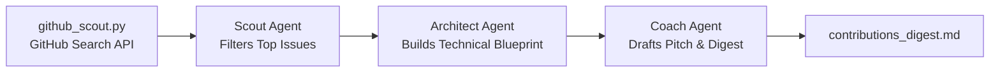

# 🎯 Open-Source Contributor Scout Agent

An autonomous multi-agent Crew designed to **scout, evaluate, and blueprint beginner-friendly open-source contributions** on GitHub tailored to your preferred language and stack.

---

## 💡 Why This Agent?

- **Eases Your Life:** Replaces hours of searching GitHub for `good first issue` tags, sorting through dead repos, or getting stuck with abandoned tickets.
- **Enhances Your Profile:** Identifies high-visibility repositories and produces a step-by-step PR implementation plan plus a ready-to-paste maintainer comment to get issues assigned to you.

---

## 🤖 The Multi-Agent Architecture



1. **Open Source Scout:** Filters out spam, dead tickets, or trivial single-character typo fixes. Identifies 2-3 high-credibility issues in active repositories.
2. **PR Solution Architect:** Analyzes the issue text, pinpoints the likely files/functions involved, and develops an engineering implementation & testing strategy.
3. **Contribution & Pitch Coach:** Composes a respectful, professional issue-claim comment ready to post on GitHub, and compiles everything into a markdown digest.

---

## 🚀 Quickstart

### 1. Prerequisites & Installation

You can reuse your existing virtual environment or create a new one:

```powershell
# In E:\projects\AiAgentS\oss-contributor-scout
pip install -r requirements.txt
```

### 2. Configure Environment

Copy `.env.example` to `.env`:

```powershell
cp .env.example .env
```

Set your keys:
- `GEMINI_API_KEY`: Your Gemini API key.
- `GEMINI_MODEL`: `gemini/gemini-3.8-flash` (or `gemini/gemini-1.5-flash`).
- `GITHUB_TOKEN` *(Optional)*: Free personal access token from GitHub to avoid hitting rate limits.
- `TARGET_LANGUAGE`: `python`, `typescript`, `go`, etc.
- `TARGET_TOPIC`: `ai`, `fastapi`, `cli`, or leave empty for all topics.

### 3. Run the Agent

```powershell
python crew_scout.py
```

### 4. Output

The agent generates `contributions_digest.md` with:
- Target repositories with star counts and credibility notes
- Summary of the issue and why it showcases your skill
- Step-by-step engineering plan
- Copy-paste ready GitHub comment for the issue thread

