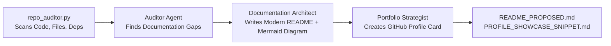

# ✨ GitHub Repo & Portfolio Polisher Agent

An autonomous multi-agent Crew that audits any repository and generates **world-class READMEs with Mermaid architecture diagrams, badges, and quickstarts**, plus **profile showcase cards** for your personal GitHub profile.

---

## 💡 Why This Agent?

- **Eases Your Life:** Never spend hours figuring out how to draw architecture diagrams or format Markdown tables for environment variables.
- **Enhances Your Profile:** 90% of developers are judged by their repo README. This agent gives your projects the visual polish and technical clarity of a top-tier open-source product.

---

## 🤖 The Multi-Agent Architecture



---

## 🚀 Quickstart

### 1. Installation

```powershell
# In E:\projects\AiAgentS\repo-polisher
pip install -r requirements.txt
```

### 2. Configure Environment

Copy `.env.example` to `.env`:

```powershell
cp .env.example .env
```

Set:
- `GEMINI_API_KEY`: Your Gemini API key.
- `TARGET_REPO_PATH`: Path to any repo you want to polish (e.g. `../oss-contributor-scout`).

### 3. Run the Agent

```powershell
python crew_polisher.py ../ai-news-agent
```

### 4. Output Files

- `README_PROPOSED.md`: The upgraded, badge-rich README ready to replace your old one.
- `PROFILE_SHOWCASE_SNIPPET.md`: A 3-bullet project card ready to paste into your personal `github.com/username/username` profile README.

