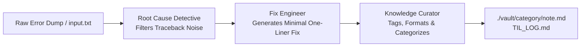

# 📚 Second-Brain & Error Archivist Agent

An autonomous multi-agent Crew that ingests chaotic terminal errors, traceback dumps, or obscure bugs, isolates the **exact technical root cause**, provides the **verified one-liner fix**, and saves it into a **structured personal knowledge vault and public Today-I-Learned (TIL) log**.

---

## 💡 Why This Agent?

- **Eases Your Life:** Never spend hours re-googling the same obscure dependency conflict, DLL error, or environment glitch you solved 3 months ago.
- **Enhances Your Profile:** Creates an automatic `TIL_LOG.md` and structured `./vault/` that you can publish as a standalone GitHub "Today-I-Learned" repository—one of the most popular ways developers show consistency and deep technical problem solving.

---

## 🤖 The Multi-Agent Architecture



---

## 🚀 Quickstart

### 1. Installation

```powershell
# In E:\projects\AiAgentS\second-brain-archivist
pip install -r requirements.txt
```

### 2. Configure Environment

Copy `.env.example` to `.env`:

```powershell
cp .env.example .env
```

Set your `GEMINI_API_KEY`.

### 3. Run the Agent

You can pass the error directly as a CLI argument or paste it into `input.txt`:

```powershell
# Option A: Paste into input.txt, then run:
python crew_archivist.py

# Option B: Pass directly from terminal:
python crew_archivist.py "ModuleNotFoundError: No module named 'crewai.tools'"
```

### 4. Output

- Creates categorized notes in `vault/<category>/<timestamp>_<slug>.md`
- Updates `TIL_LOG.md` with timestamped clickable links.

